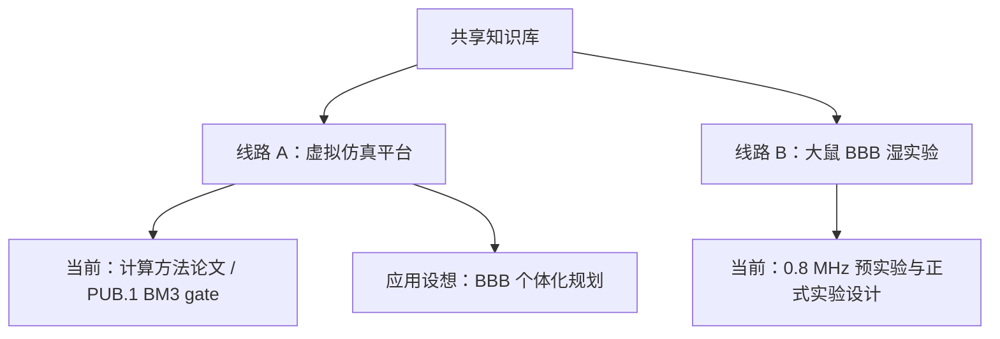

# fus-sim 知识库

> [!important] 现在在做什么
> 这里有两条彼此独立的研究线路：**虚拟仿真平台**和**大鼠 BBB 湿实验**。虚拟平台当前执行计算方法论文，PUB.1 的 BM1 已完成，下一步是 BM3 的事前 EDD/资源门；大鼠实验按自己的动物实验设计、参数和判读标准推进。两条线可以共享文献，但不共享进度、参数结论或验证声称。

## 三个入口

| 需求 | 进入 |
|---|---|
| 进入虚拟仿真平台 | [[实验平台阶段看板]] |
| 直接读虚拟平台论文 | [[01_虚拟平台核心论文入口]] |
| 进入大鼠 BBB 实验 | [[02_大鼠BBB实验/00_大鼠BBB实验入口]] |
| 查概念、论文或历史资料 | [[知识库总索引]] |
| 查看 Codex + DS 维护规则 | [[协作与维护说明]] |

## 当前关系

## 只记住这四点

- 虚拟平台进度：[[实验平台阶段看板]]。
- 虚拟平台论文：[[01_虚拟平台核心论文入口]]。
- 虚拟平台的 BBB 应用设想：[[18_虚拟平台_BBB个体化规划应用设想]]。
- 大鼠实验入口：[[02_大鼠BBB实验/00_大鼠BBB实验入口]]。
- 两条线路之间只做明确标注的知识引用，不直接做参数换算或结果验证。

> [!note] 使用原则
> 首页不再堆放 MOC 和论文。所有主题导航、报告、数据和论文统一放入 [[知识库总索引]]。
