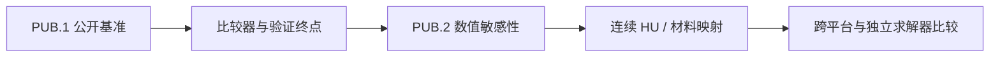

# 虚拟仿真平台论文阅读入口

> [!warning] 先看原文状态
> 本页主要组织阅读顺序，其中的 Markdown 文件是论文笔记，不等于论文原文。先进入 [[01_虚拟仿真平台/02_论文原文/00_原文核验索引]] 查看本地全文、版本类型和核验状态；参数与结论以原文为准。

## 原文入口

- [[01_虚拟仿真平台/02_论文原文/00_原文核验索引|打开虚拟平台原文核验索引]]
- 当前只纳入 11 份本地可打开的公开全文、作者接受稿或预印本。
- 没有本地全文的论文不进入本页，也不用于支撑平台参数或结论。

## 现在先读：PUB.1 BM3/BM4 公开基准与验证

1. [[05_论文与概念/notes/14_Montanaro2021_the_impact_of|Montanaro 2021：CT 参数与颅骨异质性]]
   - 用途：为 CT 输入、重建参数和模型敏感性建立边界。
2. [[05_论文与概念/notes/25_Pasquinelli2020_transducer_modeling_for|Pasquinelli 2020：换能器模型]]
   - 用途：说明自由场标定和换能器几何不能被忽略。
3. [[01_虚拟仿真平台/02_论文原文/ITRUSST2024_standardised_reporting_original.pdf|ITRUSST 2024 标准化报告原文]]
   - 用途：确定必须报告的换能器、自由场、脉冲和在体暴露参数。
4. [[05_论文与概念/notes/27_Li2026_experimental_validation_of|Li 2026：颅骨模型实验交叉验证]]
   - 用途：补充理解实验比较终点；仅作为尚未同行评审的预印本证据。

## 平台基础：求解器、传播与相位校正

- [[05_论文与概念/notes/01_Treeby2010_kWave|Treeby & Cox 2010：k-Wave 工具箱]]
- [[05_论文与概念/notes/03_Leung2019_rapid_beam_simulation|Leung et al. 2019：经颅 FUS 快速声束仿真]]
- [[05_论文与概念/notes/04_Jin2020_open_source_phase_correction|Jin et al. 2020：开源经颅相位校正]]

## PUB.2 以后：CT、颅骨与材料映射

- [[05_论文与概念/notes/21_Yin2023_transcranial_ultrasonic_focusing|Yin 2023：基于 micro-CT 的相控阵经颅聚焦]]
- [[05_论文与概念/notes/26_Kong2025_a_novel_method|Kong 2025：基于孔隙率指数的颅骨声学建模]]

## 安全与实施边界

- [[01_虚拟仿真平台/02_论文原文/ITRUSST2023_biophysical_safety_preprint.pdf|ITRUSST 生物物理安全共识预印本]]
- [[01_虚拟仿真平台/02_论文原文/ITRUSST2024_practical_guide_preprint.pdf|ITRUSST 实用指南预印本]]

这两份原文只用于约束报告与安全讨论，不能替代当前平台自己的实验验证。

## 和当前进度的关系

- 当前看板：[[实验平台阶段看板]]
- BM1 权威比较：`outputs/itrusst_bm1_sc1_axisymmetric_ppw12_20260803/comparison.json`
- 当前基线：[[当前实验基线_Case079]]
- 完整证据路线：[[03_知识地图/MOC_虚拟仿真平台证据与复现路线]]
